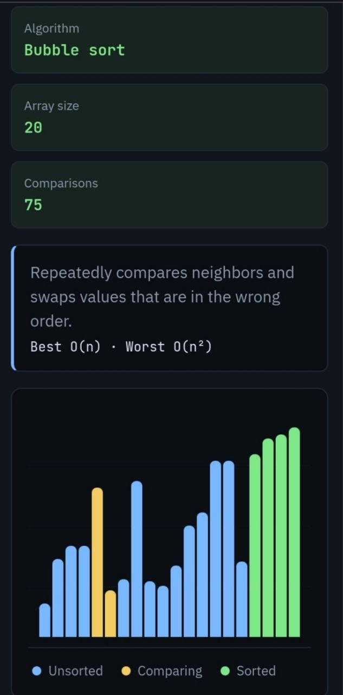

# Sorting Visualizer

An interactive visualizer that animates Bubble, Selection and Insertion sort step by step.

## Live Demo

https://sorting-visualizer-app-sigma.vercel.app/

## Screenshot



## Features

- Bubble Sort, Selection Sort, and Insertion Sort
- Animated comparisons with unsorted, comparing, and sorted bar colors
- Custom number input with clear validation:
  - 2 to 30 numbers
  - Each number from 1 to 1000
  - Empty and non-numeric values are rejected
- Animation speed slider
- Stop button for cancelling a running sort
- Live comparison counter and sorting statistics
- Algorithm info card with best-case and worst-case time complexity
- Number labels shown above bars (hidden on small screens when there are more than 15 bars)
- Responsive layout for phone-sized screens
- Keyboard focus styles and screen-reader status support

## Tech Used

- HTML
- CSS
- Vanilla JavaScript
- `async/await` and `Promises` for step-by-step animation
- No frameworks or build step

## How It Works

The data starts as a plain JavaScript array of numbers. `renderBars()` turns each number into a bar and calculates a height that fits the chart container.

Each sorting algorithm is an asynchronous function that compares or moves values and then pauses before the next step. `pause()` uses a Promise with `setTimeout()`, and the speed slider controls the delay.

The number of comparisons is updated live while the sort runs. A stop flag lets an algorithm exit cleanly after the current pause.

The Stop flow redraws the array in its current state without marking anything as fully sorted because of the stop.

## Time Complexity

| Algorithm | Best case | Worst case |
| --- | --- | --- |
| Bubble Sort | O(n) | O(n²) |
| Selection Sort | O(n²) | O(n²) |
| Insertion Sort | O(n) | O(n²) |

## Run It Locally

Open `index.html` directly in a browser, or run a simple local server in the project folder:

```bash
python -m http.server 8000
```

Then visit `http://localhost:8000`.

## What I Learned

- In insertion sort, stopping mid-shift could duplicate a value because I had not written the held `currentValue` back. I fixed it by restoring that value before exiting.
- Bubble sort can finish in O(n) on an already sorted array when a `swapped` flag detects that a full pass made no swaps.
- Bar heights are more reliable when they use the chart container's real available height instead of a hardcoded height.
- My speed slider was backwards at first because higher slider values meant longer pauses. I corrected it by inverting the slider value when calculating the delay.

## Author

**Olawale Isreal Feranmi**

- [GitHub](https://github.com/Acedigitals)
- [Portfolio](https://olawale-isreal-feranmi-portfolio-zeta.vercel.app)
